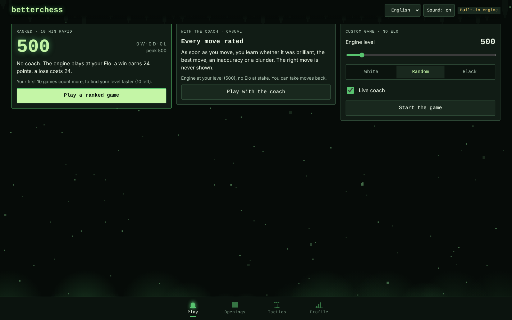
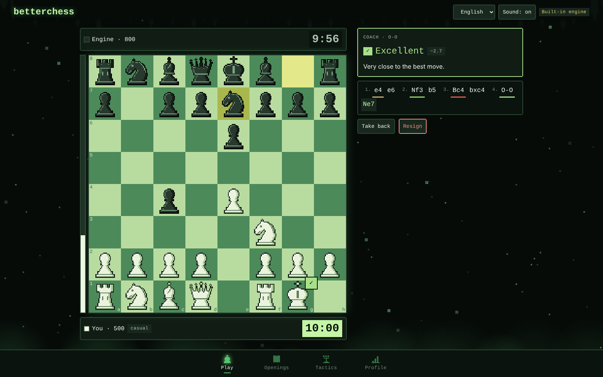
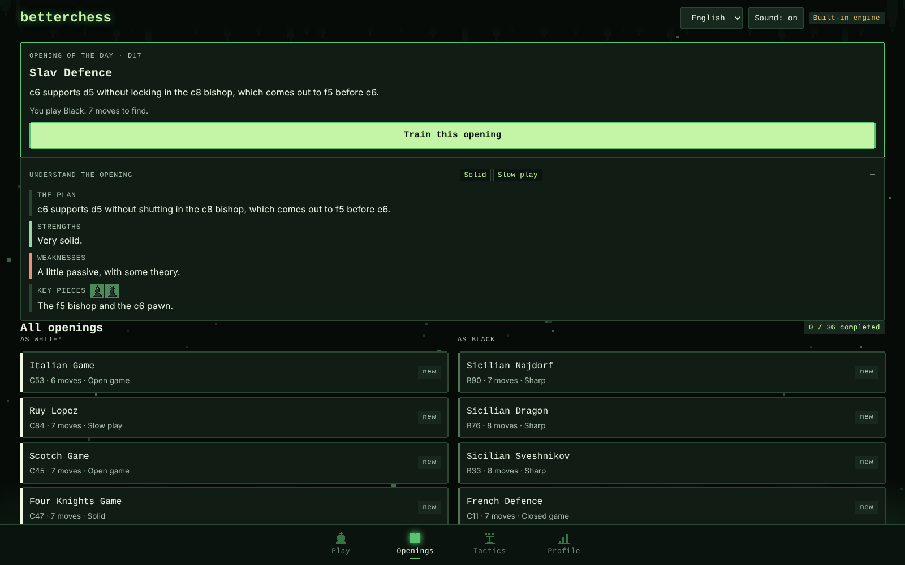
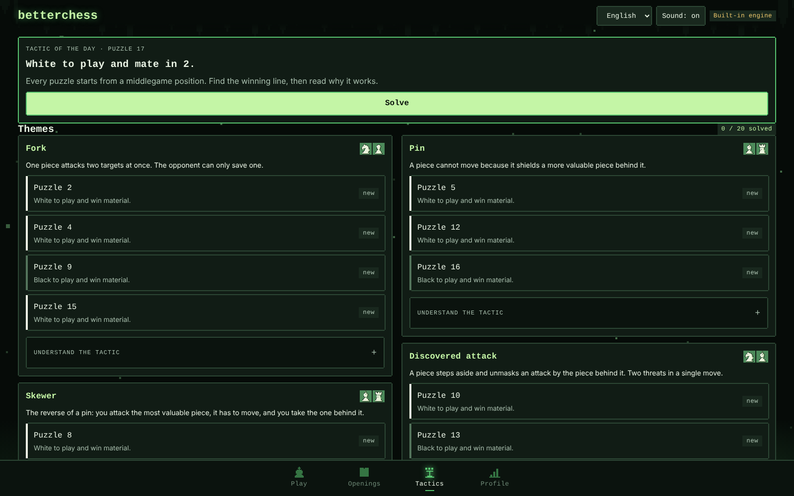
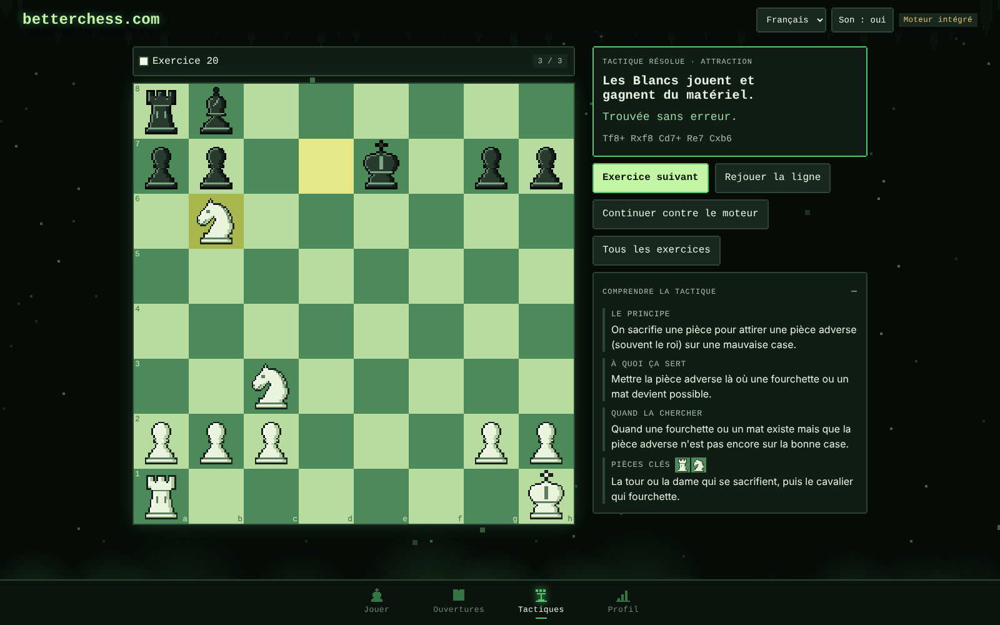
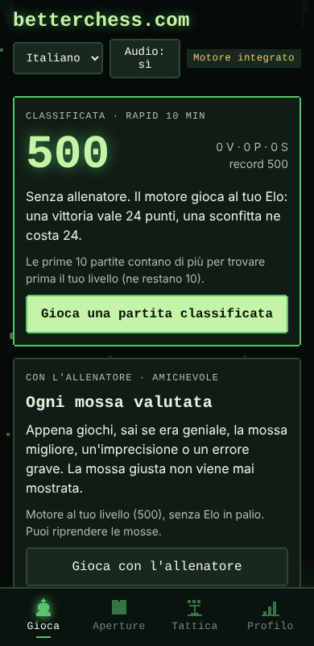

# betterchess

A free chess trainer that runs entirely in your browser. No account, no server, no ads: open one HTML file and play.



## Why this exists

Good training tools (move-by-move feedback, opening drills, an opponent that matches your level) usually sit behind a subscription. betterchess puts the essentials in a single static page that anyone can download, host or modify.

## What it does

- **Ranked games, 10-minute rapid.** You start at 500 Elo and the engine plays at your current rating. Win and it gets stronger, lose and it eases off. Your Elo is the level of the engine you can hold your own against.
- **Coach mode.** Every move you play is rated on the spot: brilliant, great, best, excellent, good, book, inaccuracy, mistake, miss or blunder. The coach never shows the best move, so you find out by playing.
- **Opening trainer.** 36 opening lines for White and Black, with an opening of the day. Replay each line move by move, then continue the position against the engine.
- **Tactics trainer.** 20 middlegame puzzles across 11 themes (fork, pin, skewer, discovered attack, double check, back-rank mate, smothered mate, decoy, promotion, removing the defender, kiss of death), with a tactic of the day. The theme stays hidden until you ask for it or solve the puzzle.
- **Understand, not just memorise.** Every opening explains its plan, its strengths, its weaknesses and the pieces that matter, with style tags (aggressive, solid, gambit, slow play…). Every tactic explains what it is, what it is for, when to look for it and which pieces make it work.
- **Custom games.** Pick the engine level, your colour and whether the coach is on.
- **Profile.** Elo curve, game history and accuracy, stored in your browser.
- **Five languages.** English, French, Spanish, German and Italian. The page follows your browser language and falls back to English.
- **Sounds** synthesised in the browser, original pixel-art pieces, works on phone and desktop.











## Run it

- **Locally:** download the repository and open `index.html` in a browser.
- **Online:** enable GitHub Pages on the repository (Settings → Pages → deploy from the main branch, root folder).

There is nothing to install and no backend to deploy.

## How it works

No framework, no bundler, no dependency: plain JavaScript files loaded in order by `src/index.html`.

```
index.html              the complete site in one file, generated by build.js
build.js                inlines src/ into index.html
src/
  index.html            development page: open it directly, no build needed
  style.css
  chess/core.js         rules, move generation, notation, the built-in engine
  data/                 openings.js, themes.js, tactics.js (generated, see tools/)
  i18n/                 i18n.js (t(), language detection) and one file per language
  ui/
    util.js  board.js  pieces.js  sound.js  backdrop.js   shared helpers, board, sprites, sounds, background
    store.js            profile saved in localStorage, with hooks for extra scripts
    engine.js           Stockfish in a Web Worker, built-in engine as fallback
    coach.js            move ratings, bot move choice, Elo
    book.js             opening book built from data/openings.js
    game.js             games against the engine and the lobby
    trainer.js          shared logic of opening drills and puzzles
    openings.js  tactics.js  profile.js  learn.js         the tabs and the explanation panels
    app.js              tabs, header, click handling (buttons declare data-act="…")
    main.js             start-up
tools/                  build-tactics.js checks the puzzles and writes src/data/tactics.js
test/run.js             tests, no dependency
```

The opponent and the analysis use [Stockfish](https://stockfishchess.org/) (the `stockfish.js` build), loaded from a public CDN when the page opens. If it cannot load (offline, blocked CDN), the built-in engine takes over; it is much weaker, roughly club-beginner level.

## Develop

- Open `src/index.html` in a browser and edit the files in `src/`: a reload shows the change.
- `npm test` (or `node test/run.js`) checks the chess rules, that every opening and puzzle line is legal, that every language has all the texts, and the coach's move classes.
- `npm run build` (or `node build.js`) regenerates `index.html`. Options: `--title`, `--out`, and `--extra file.js` to add your own script before start-up, for example to save the profile somewhere else with `Store.onSave` and `Store.replace`.
- To change the puzzles, edit `tools/tactics-source.js`, then run `node tools/build-tactics.js`: it checks each line with the engine and refuses ambiguous ones.

## Add a language

1. Copy `src/i18n/en.js` to `src/i18n/<code>.js` (for example `pt.js`), change `I18N.en` to `I18N.pt` and translate the values. Keep the keys. `pieces` holds the piece letters in the order king, queen, rook, bishop, knight.
2. Add `<script src="i18n/pt.js"></script>` next to the other languages in `src/index.html`.
3. Run `npm test`: it lists any missing text or placeholder. Then `npm run build`.

The language picker lists every language it finds, so there is nothing else to wire up.

## Limits

- The Elo is a home-made scale. It is consistent inside betterchess but is not calibrated against chess.com, Lichess or FIDE ratings.
- The 20 puzzles were checked with the built-in engine, which is much weaker than Stockfish; two lines were checked by hand. Five of them are mirrored versions of others, so you also practise the patterns with Black.
- Move ratings come from a short engine search, so they are less reliable than a full game review, and the "brilliant" label is a heuristic.
- Progress is saved in the browser's local storage: it does not follow you to another browser or device, and clearing site data erases it.
- A game in progress is lost if you reload the page.
- Pieces move by tapping the piece, then the square. There is no drag and drop.
- Right-to-left languages are not supported yet.

## Licence

GPL-3.0, see `LICENSE`. Stockfish is GPL-3.0 software by the Stockfish developers. The pieces, sounds and all other code in this repository are original.

---

## En français

betterchess est un entraîneur d'échecs gratuit qui tourne entièrement dans le navigateur, sans compte ni serveur. Il propose des parties classées de 10 minutes contre un moteur qui joue à ton Elo, un entraîneur qui note chaque coup sans jamais montrer le meilleur, 36 ouvertures et 20 exercices de tactique, chacun expliqué (plan, forces, faiblesses, pièces clés), des parties personnalisées et cinq langues. Pour l'utiliser, télécharge le dépôt et ouvre `index.html`, ou active GitHub Pages.
